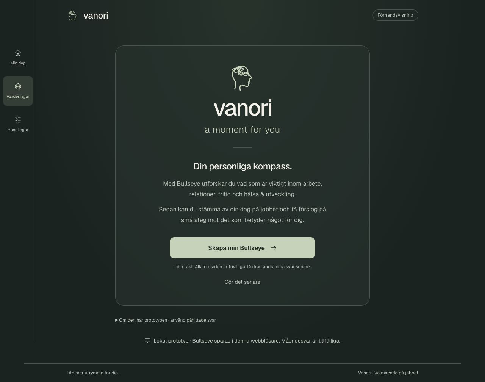
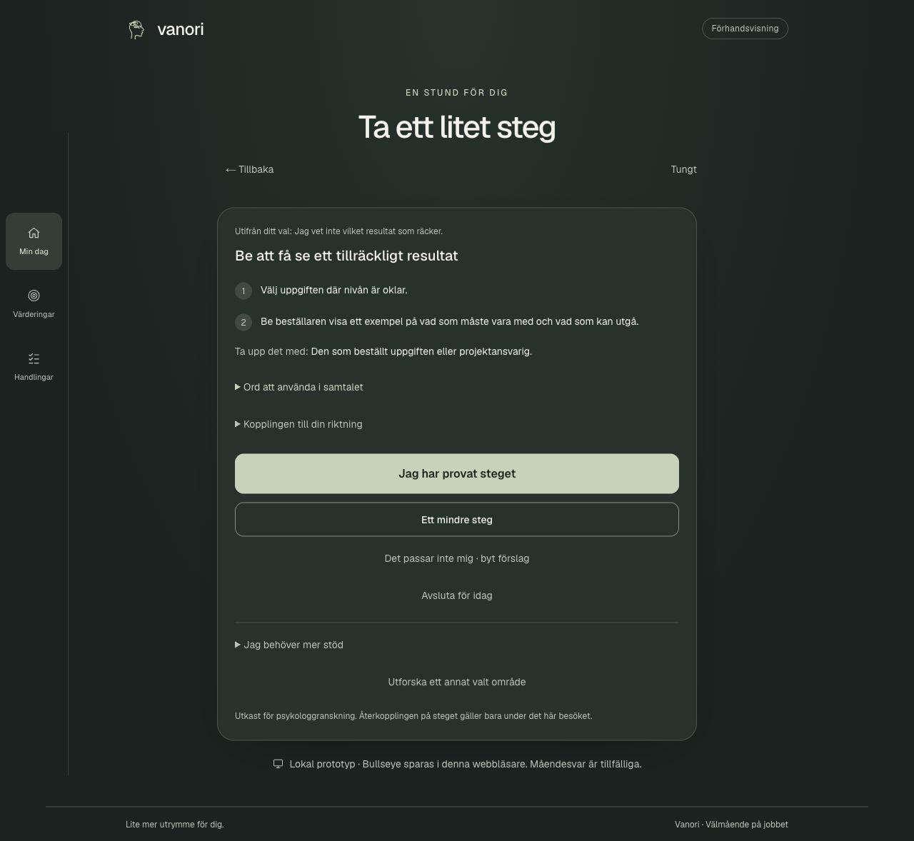
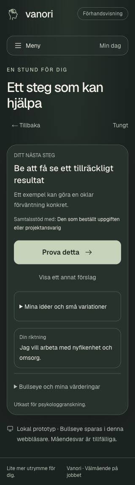

# Vanori, a moment for you

En mobilanpassad frontendprototyp för medarbetares välmående på jobbet. Vanori kopplar en kort daglig incheckning till personliga värderingar och konkreta små handlingar.

**Status:** portfolioprojekt under utveckling. Prototypen använder skrivna exempel och lokalt sparade testuppgifter. Den är inte en färdig eller kliniskt validerad behandling.



## Idén

När jobbet känns svårt kan det vara hjälpsamt att både förstå situationen och hitta ett litet nästa steg. Vanori utforskar detta genom en lugn, stegvis upplevelse:

1. **Min Bullseye:** reflektera över vad som är viktigt inom arbete, relationer, fritid samt hälsa och utveckling. Alla områden är frivilliga.
2. **Min dag:** välj hur jobbet känns idag. Bra, okej och tunga dagar får olika vägar.
3. **Min situation:** utforska vad som påverkar dagen och välj ett fokus när flera saker är aktuella.
4. **Ett litet steg:** få ett skrivet stödförslag, prova en konkret handling och återkoppla frivilligt.

Bullseye används som inspiration för värderingsarbete inom ACT. Frågor, kopplingar och stödförslag i denna prototyp behöver psykologgranskas; de utgör inte ett validerat bedömningsinstrument.

## Det går att prova idag

- Välkomstsida och Bullseye-formulär vid första besöket. När formuläret avslutats startar följande besök med dagens incheckning i samma webbläsare.
- Fem måendenivåer, med separata positiva, neutrala och stödjande flöden.
- Sju stödområden, från arbetsbelastning och krav till relationer, fokus och återhämtning.
- Fördjupning av situationen, flera val och möjlighet att utforska ett område i taget.
- Stöd kopplat till en föreslagen värderingsriktning, egna handlingar och skrivna variationer av exempelvis promenader och rörelse.
- Konkreta handlingssteg, mindre alternativ och samtalsstöd med tydliga roller och exempel på formuleringar.
- Meny för Min dag, Mina värderingar och Mina handlingar, anpassad för mobil och dator.

Stödet bygger på explicita val och författat innehåll. Appen använder ingen AI-tjänst för att tolka svar eller generera råd.

## Skärmbilder

Alla exempel i bilderna är påhittade.

| Ett konkret nästa steg på dator | Personligt stöd på mobil |
| --- | --- |
|  |  |

## Teknik och arkitektur

**Next.js 16 · App Router · React 19 · strikt TypeScript · Tailwind CSS 4**

UI, flödesregler och stödtexter ligger separat. De sex nyare stödområdena använder samma frågemotor; arbetsbelastningens ursprungliga gren har fortfarande egen flödeslogik. De delar komponenter för stöd och handlingar. Detta är ett steg mot en mer datastyrd struktur, inte ett färdigt generellt ramverk.

```text
src/
  app/                  Startsida, layout, globala stilar och ikoner
  components/
    employee/           Incheckning, Bullseye och stödflödets skärmar
    ui/                 Återanvändbara knappar, kort, fält och rubriker
  lib/
    employee/           Flödesregler, svarstillstånd och skrivet innehåll
tests/                  Tester för regler, navigation och lokal profil
docs/                   Designsystem, projektguide och skärmbilder
```

Designen utgår från mobil, semantiska formulär, tangentbordsstöd och synliga fokusmarkeringar. Se [designsystemet](docs/design-system.md) och [den detaljerade projektguiden](docs/prototype-guide.md).

## Min roll och arbetssätt

Jag har drivit produktidén, prioriterat funktioner och format användarflöden, design och krav genom återkommande granskning av prototypen. Samtal med en psykolog har påverkat inriktningen, bland annat arbetet med värderingar och Bullseye.

Implementationen har tagits fram med AI-stöd i Codex. Projektet visar därför mitt arbete med produktutveckling, kravställning och iterativ granskning tillsammans med AI. Det innebär inte att hela kodbasen är självständigt skriven av mig eller att allt psykologiskt innehåll är godkänt av en psykolog.

## Kör lokalt

Du behöver Node.js **20.9 eller senare** och npm. Stå i projektmappen där `package.json` finns:

```sh
npm ci
npm run dev
```

Öppna [localhost:3000](http://localhost:3000). Använd endast påhittade svar.

För att prova flödet snabbt kan du välja **Gör det senare** på välkomstsidan. För att prova den personliga kopplingen fyller du istället i en Bullseye med påhittade värderingar och handlingar.

## Lagring och begränsningar

Bullseye och formulärets status sparas i `localStorage` i den aktuella webbläsaren. De kan redigeras eller raderas under Mina värderingar. Vid blockerad lagring fungerar formuläret med tillfälliga svar.

Dagens incheckning och återkoppling finns endast i minnet och försvinner vid omladdning. Svar läggs inte i URL:en eller webbläsarhistoriken.

Det finns **ingen autentisering, databas, chefsrapportering eller AI-integration**. Lokal lagring är inte skyddad per person: andra som använder samma webbläsare kan komma åt den lokala Bullseye-profilen. Prototypen är därför avsedd för syntetiska testuppgifter.

## Verifiering

```sh
npm test
npm run lint
npx tsc --noEmit
npm run build -- --webpack
```

Tester använder Nodes inbyggda testverktyg utan extra testberoenden. De täcker bland annat navigation, flera val, bevarade svar, lokal profil och regler för stödinnehåll. Mobilvy, kontrast och tangentbordsinteraktion har även kontrollerats manuellt; en fullständig tillgänglighetsgranskning återstår.

## Nästa steg

- Psykologgranska frågor, råd och kopplingar till värderingar samt testa begriplighet med användare.
- Fortsätta förenkla innehållet och samla fler grenar i den gemensamma flödesstrukturen.
- Planera autentisering och privat datalagring med dataminimering, lagringstid och radering innan riktiga svar används.
- Utforma serverbaserade behörigheter och skydd för små grupper innan någon chefsstatistik införs. Chefer ska aldrig kunna läsa enskilda medarbetares svar.
- Genomföra säkerhets- och tillgänglighetsgranskning inför en pilot.

Se [AGENTS.md](AGENTS.md) för projektets utvecklingsprinciper.
